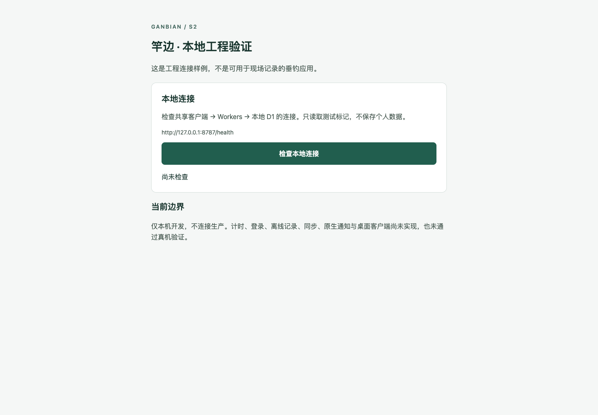
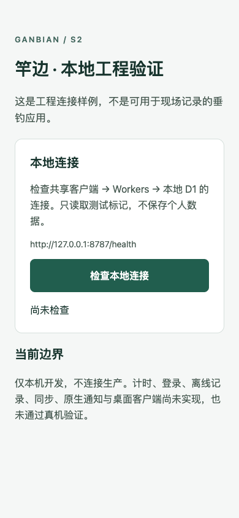

# 页面原型 · 实际浏览器证据

## 比较边界

- 目标分支基线：`39006af`（已合并需求说明），只有文档，没有可运行页面，因此不存在可截取的旧业务页面。
- **Before**：`d0d4b745b1725b4d630c68d3e5e56c9624967999`，同一项目 S2 工程骨架的真实本地连接验证页，来自既有本地 Web 导出构建。它是此前用户询问效果时唯一实际存在的应用页面，不是本 PR 父提交，也不是旧版业务 UI。没有将新设计伪装成旧页面。
- **After**：本 PR 提交中的独立 `prototype/` 页面。与 Before 都是本地浏览器、light 配色、相同桌面 1440×1000 和手机 390×844，初始未操作状态。S2 连接保持未检查，原型模拟数据保持初始状态；二者都是入口页场景，但职责不同，不代表原工程页面被替换。
- 使用实际 Chromium 页面截图；无凭据或私密消息内容。其他原型路由此前不存在，对应旧版截图不适用。
- 自动检查无水平溢出和页面异常，另验证交互。当前执行模型无法读取图片输入，因此未宣称已逐像素人工目视评审；图片供设计评审使用。

## Before

| 桌面 | 手机 |
| --- | --- |
|  |  |

## After

| 页面 | 桌面 | 手机 |
| --- | --- | --- |
| 首页 | [查看](home-desktop.png) | [查看](home-mobile.png) |
| 出钓准备 | [查看](prepare-desktop.png) | [查看](prepare-mobile.png) |
| 单竿设置 | [查看](rod-0-desktop.png) | [查看](rod-0-mobile.png) |
| 垂钓中 | [查看](fishing-desktop.png) | [查看](fishing-mobile.png) |
| 历史记录 | [查看](history-desktop.png) | [查看](history-mobile.png) |
| 历史详情 | [查看](detail-desktop.png) | [查看](detail-mobile.png) |
| 统计分析 | [查看](stats-desktop.png) | [查看](stats-mobile.png) |
| 我的目录 / 模拟潮汐 | [查看](catalog-desktop.png) | [查看](catalog-mobile.png) |
| 个人设置 | [查看](profile-desktop.png) | [查看](profile-mobile.png) |

重新采集方法见 [原型说明](../../prototype/README.md)。截图是页面效果，不是已实现真实记录、计时、存储、通知或同步的证据。
